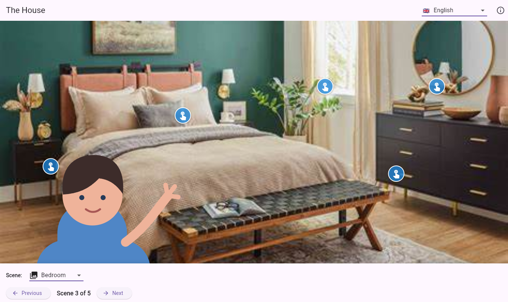
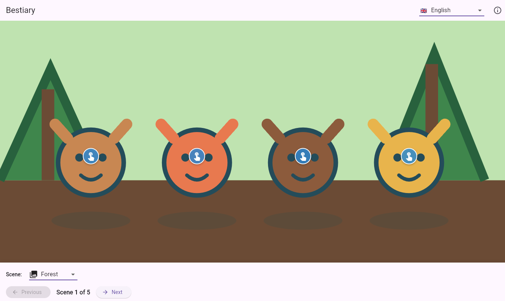

# Vocabular

**An interactive multilingual pronunciation and vocabulary trainer built with Flutter for Web, Linux, and Android.** Vocabular is the application in the `vocabulars` repository: choose a themed scene, tap an object, and learn its name, translation, and pronunciation in context.

## [Try the Live Web Demo](https://nulvox.github.io/vocabulars/)

[](https://github.com/nulvox/vocabulars/actions/workflows/ci.yml)
[](https://github.com/nulvox/vocabulars/actions/workflows/release.yml)
[](https://nulvox.github.io/vocabulars/)
[](LICENSE)

## Visual Preview

The same scene-driven UI adapts to different vocabulary packs. Learners select a language and scene, then use the highlighted interaction points to reveal vocabulary and play bundled pronunciation audio.

| The House | Bestiary |
| --- | --- |
| [](https://nulvox.github.io/vocabulars/house/) | [](https://nulvox.github.io/vocabulars/bestiary/) |

Each pack is driven by configuration rather than a separate application:

```text
configs/*.json
    │ select + validate
    ▼
assets/vocabulary.json ──► metadata/icon generation
    │
    ├──► TTS pronunciation assets
    └──► Flutter application
              ├── Web bundle ──► GitHub Pages
              ├── Android APK ─► GitHub Release
              └── Linux desktop build
```

## Engineering Highlights

- **Cross-platform Flutter delivery** — one Dart codebase supports the hosted Web experience, Android APKs, and Linux desktop builds, with additional Flutter platform scaffolding retained in the repository.
- **Configurable vocabulary packs** — reusable JSON configs control the app name, icon, scenes, images, interaction points, languages, and translations. The current demos showcase household vocabulary and a themed bestiary.
- **Reproducible tooling with Nix** — `flake.nix` and `flake.lock` provide Flutter, Dart, Python dependencies, Android tooling, and Linux desktop libraries in a pinned development shell.
- **Validated content pipeline** — Python tooling selects packs, checks vocabulary structure, generates synchronized platform metadata, and validates that distributable builds include required audio.
- **Build-time pronunciation generation** — TTS audio is prepared and bundled before release rather than depending on a runtime service or exposing credentials in the client.
- **Automated quality and releases** — CI audits workflows with `zizmor`, evaluates the Nix flake, validates content, runs tests and static analysis, and builds the Web target. Version tags produce per-pack Web bundles and Android APKs, deploy the demos to GitHub Pages, and publish release artifacts.

## Development & Build

### Prerequisites

The recommended environment is Nix with flakes enabled. The project can also be used with an existing Flutter 3 / Dart 3 installation; Android and Linux builds require their corresponding native toolchains.

### Reproducible Nix environment

```bash
git clone https://github.com/nulvox/vocabulars.git
cd vocabulars
nix develop
flutter pub get
flutter test
flutter run
```

To run the Web target during development:

```bash
flutter run -d chrome
```

### Build a vocabulary pack

`assets/vocabulary.json` is the active build input. The wrapper selects a config, generates metadata and pronunciation assets, validates the result, and then invokes Flutter:

```bash
# Web release
./scripts/build_with_audio.sh \
  --config configs/house.json \
  build web --release --no-wasm-dry-run --no-tree-shake-icons

# Android release APK
./scripts/build_with_audio.sh \
  --config configs/house.json \
  build apk --release

# Linux desktop release
./scripts/build_with_audio.sh \
  --config configs/house.json \
  build linux --release
```

The Web output is written to `build/web`. Review it locally with:

```bash
python3 -m http.server 8000 --directory build/web
```

Swap `configs/house.json` for `configs/bestiary.json` to build the other included demo. Platform-specific builds require the relevant SDK and native build tools.

### Content and audio workflow

Create custom scenes, translations, images, and interaction points using the documented [content format](docs/content-format.md). Audio is generated during content preparation and the resulting MP3 files are intentionally ignored by Git.

```bash
nix develop
python scripts/generate_audio.py --dry-run
python scripts/generate_audio.py --update-json
python scripts/validate_vocabulary.py --require-audio
```

The default no-login generator uses the Google Translate TTS endpoint. An authenticated Cloud TTS provider is also supported; see the [pronunciation plan](docs/audio-pronunciation-plan.md) for provider details and review guidance.

### Quality checks

Run the same core checks used by CI:

```bash
nix flake check --no-build
nix develop --command zizmor .github/workflows
flutter analyze --no-fatal-infos
flutter test
python scripts/validate_vocabulary.py
python scripts/generate_audio.py --dry-run
```

If model classes change, regenerate serializers with:

```bash
dart run build_runner build --delete-conflicting-outputs
```

See the [development workflow](docs/development.md) for content selection, Nix environment details, CI expectations, and data-model guidance. See [releases](docs/releases.md) for versioning, tagging, GitHub Pages deployment, and APK publication.

## Project Layout

- `lib/` — Flutter application, models, services, screens, and widgets
- `configs/` — reusable vocabulary pack definitions
- `assets/` — selected vocabulary data, images, and generated-audio manifest
- `scripts/` — selection, validation, metadata, audio, and build tooling
- `docs/` — content format, development, pronunciation, and release documentation
- `test/` — model, service, and widget tests

## Contributing

Create a branch, run the quality checks above, and open a pull request. Content changes should pass validation and include a review of generated pronunciations where appropriate.

## License

Vocabular is licensed under the [MIT License](LICENSE).
